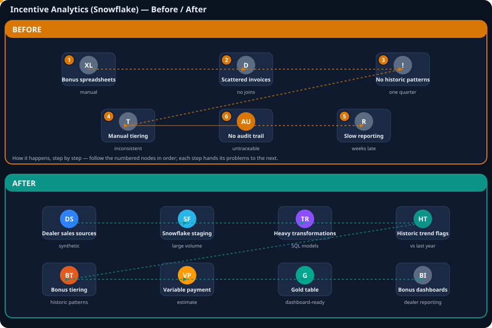

# Incentive Analytics with Snowflake

Synthetic dealer sales and bonus data, Snowflake-style SQL transformations
with a runnable Python mirror for local tests, and a dashboard-ready gold
table. All data is synthetic, all code is original and clean-room, and no
proprietary code, data, schema names, or internal system details from any
employer are included. No real dealer, customer, payment, or bonus figures
are included anywhere in this repository.

**Context (portfolio version of production-style work):** pipelines and
automation for invoices, cost and dealer reporting, plus heavy Snowflake
transformations on large-volume data powering dealer bonus dashboards that
capture historic patterns and multiple parameters, and a migration
supporting dealer and customer support including dealer bonus and variable
payments data. This repo reproduces that shape on synthetic data only.

## What the pipeline does

1. **Generate** synthetic sales: several transactions per dealer per
   quarter (`src/incentive_analytics/generate_data.py`), deterministic
   for a given seed in `config.yaml`.
2. **Validate** every row: dealer/quarter format, integer units >= 0,
   transaction IDs that belong to their dealer and quarter. Bad rows are
   **quarantined** to `data/quarantine.csv` with a reason, never silently
   dropped; duplicate transaction IDs keep the first occurrence.
3. **Build gold**: one row per dealer per quarter with units, bonus tier,
   variable-payment estimate, trend flag vs the same quarter last year,
   and the prior-year units (`src/incentive_analytics/build_gold.py`).
   The build is idempotent: the same input always produces the same
   gold file, byte for byte.
4. **(Optional) Upload** the gold CSV to Snowflake with
   `python -m incentive_analytics upload`. This needs a live Snowflake
   account, `snowflake-connector-python`, and credentials from
   environment variables only. It is not run by default and no test
   touches the network.

Gold output columns: `dealer_id, quarter, units, bonus_tier,
variable_payment_estimate, trend_flag, prior_year_units`. Trend flags
are `improving` / `flat` / `declining` (a move beyond 5% either way) or
`no_baseline` for the first year in the data. Tiers are Platinum at
500+ units, Gold at 250+, otherwise Standard. The per-unit payment
rates in `config.yaml` (Platinum 150, Gold 100, Standard 50) are
illustrative synthetic parameters, not real bonus rates.

## Setup

```bash
python3 -m venv .venv && source .venv/bin/activate
pip install -r requirements-dev.txt
pip install -e .   # makes `python -m incentive_analytics` work; or use PYTHONPATH=src instead
```

Requires Python 3.10+. The only runtime dependency is PyYAML (for
`config.yaml`); the pipeline itself is standard library otherwise.

## Run

```bash
python -m incentive_analytics generate
python -m incentive_analytics build-gold
python -m pytest tests/ -q
```

Generated files land in `data/` (`sales.csv`, `gold.csv`,
`quarantine.csv`) and are git-ignored. Useful flags:

```bash
python -m incentive_analytics generate --seed 42 --dealers 10 --output data/sales.csv
python -m incentive_analytics build-gold --input data/sales.csv --output data/gold.csv --quarantine data/quarantine.csv
```

## Configuration

`config.yaml` at the repo root holds the seed, dealer count, quarters,
transactions/units ranges, tier thresholds, payment rates, trend
threshold, and file paths. `INCENTIVE_CONFIG` overrides the file
location; `INCENTIVE_SEED` overrides the seed. Invalid settings
(thresholds out of order, negative rates, empty quarters) fail fast
with a `ConfigurationError`. Thresholds and rates in `config.yaml`
must match `sql/bonus_gold.sql` if either is edited.

## Architecture



| Module | Responsibility |
|---|---|
| `config.py` | Settings dataclass, YAML loading, env overrides, validation |
| `models.py` | `SaleRecord`, `GoldRow`, `DataQualityReport`, schema gate |
| `validation.py` | Row validation, duplicate detection, quarantine |
| `tiers.py` | Tiering, variable-payment estimate, trend flag (pure functions) |
| `data_io.py` | All CSV reading/writing |
| `generate_data.py` | Deterministic synthetic generator + CLI |
| `build_gold.py` | Aggregation, gold rows, end-to-end build + CLI |
| `retry.py` | Retry with exponential backoff + jitter |
| `snowflake_loader.py` | Optional Snowflake `PUT`/`COPY INTO` upload (env credentials only) |
| `exceptions.py` | `IncentiveAnalyticsError` hierarchy |
| `logging_config.py` | One log format; logging, not `print`, everywhere |
| `sql/bonus_gold.sql` | Snowflake form of the same logic: silver dedup + gold |

<details>
<summary><b>Transformation + tiering — click to expand the 4 steps</b></summary>

Collapsed, this is just: Dealer sales sources -> Snowflake staging -> Heavy transformations -> Historic trend flags

1. Dealer sales and bonus data is the source for every transformation.
2. Staging in Snowflake is built for large-volume transformations.
3. Heavy Snowflake SQL transformations clean and conform the data at scale.
4. Historic trend flags compare each quarter with the same quarter last year.

Tiering follows: bonus tiers are set from historic patterns and multiple parameters, and the variable payment estimate is ready per dealer per quarter.
</details>

### Earlier issues, risk, and impact after

| Aspect | Detail |
|---|---|
| Earlier issues | Dealer bonuses worked out in spreadsheets, slow and hard to audit; invoice, cost and dealer data scattered, so reporting needed manual joins; no historic comparison, so a bonus could not be judged against the same quarter last year; tiers worked out by hand; reports built by hand and delivered late; a bonus figure could not be traced back to its inputs. |
| Risk | Similar dealers could get different treatment with no record of why; a disputed bonus could not be resolved; decisions used stale numbers. |
| Impact after | Heavy Snowflake transformations on large-volume data power a dashboard-ready gold table, one row per dealer per quarter; tiers come from historic patterns and multiple parameters; trend flags show improving, flat or declining against the same quarter last year; the variable payment estimate is ready for review. |

## Tests

```bash
python -m pytest tests/ -q
```

Every module has tests: tier boundaries and config-driven thresholds,
record validation (including malformed quarters, negative/non-integer
units, mismatched transaction IDs), quarantine and duplicate handling,
CSV I/O errors (missing file, missing column, empty file), generator
determinism and tier coverage, the end-to-end build (including
idempotency), retry behaviour (including fail-fast on configuration
errors), and the Snowflake loader with an injected fake connection
(no network, no credentials).

## What changed in v0.2.0 (2026-11-24)

The original code was two short scripts: a generator with import-time
side effects and hardcoded values, and a 12-line gold builder with no
validation, no logging, no trend flag, and no variable-payment estimate
(the README already claimed the last two). It also generated only one
40–220-unit row per dealer-quarter, so no quarter could ever reach the
Gold (250) or Platinum (500) tiers. v0.2.0 replaces both scripts with
the package above, fixes the generator so quarterly totals span all
three tiers, and makes the README match what the code actually does.

## Deliberately simple

- **No live Snowflake connection.** The SQL is the Snowflake form of
  the logic and the loader is a tested integration point, but this repo
  has no warehouse account; the Python mirror is what runs and is
  tested locally.
- **CSV, not a database, locally.** The local pipeline mirrors the SQL
  on CSV files so it runs anywhere with no services to start.
- **No orchestration.** No Airflow/dbt scheduling; the two CLI commands
  are the whole pipeline.
- **Synthetic rates and thresholds.** Tier cutoffs and payment rates
  are demo parameters in `config.yaml`, not production figures.
